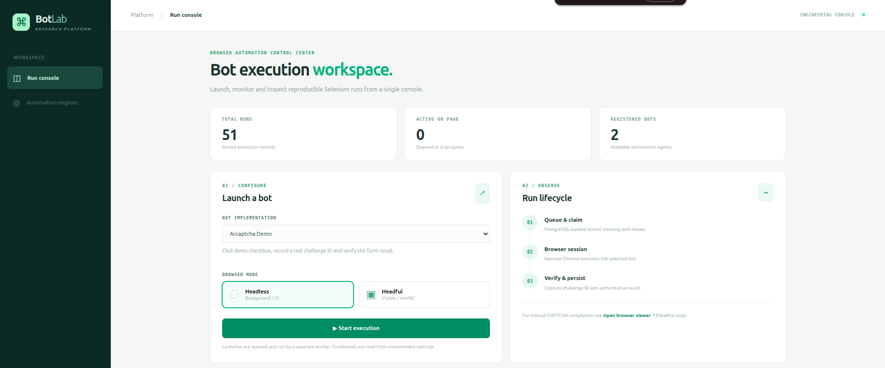
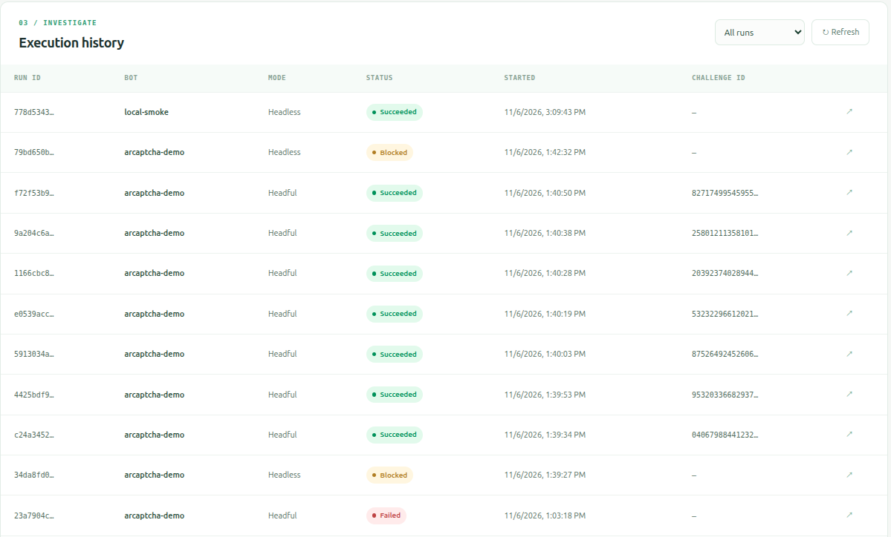
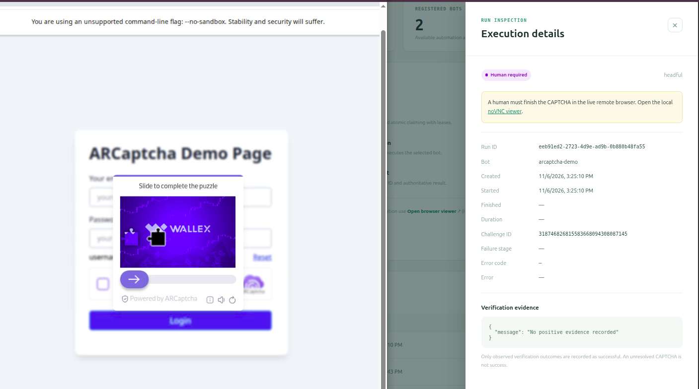

# Bot Research Engineer — Extensible Browser Bot Platform

FastAPI queues browser jobs in PostgreSQL; a dedicated worker executes registered
bots and React displays persistent history, challenge IDs, failure stages and results.
The stack uses Python 3.12, SQLAlchemy/Alembic, Selenium, PostgreSQL 16, React 19,
TypeScript and Vite. Standard Selenium Grid is the default; local
undetected-chromedriver (UC) is an optional worker backend.

**Verified Arcaptcha outcomes:** standard Grid is blocked; UC Headful completed seven
consecutive genuine logins with **human CAPTCHA completion**. UC Headless receives
`CAPTCHA_SITE_BLOCKED`. Headful Chrome on Xvfb is still Headful. This project does not
automate CAPTCHA solving or guarantee future acceptance.
[Findings and sanitized evidence](docs/ARCAPTCHA_FINDINGS.md).

## Screenshots

**Run console** — Select a bot and browser mode, then monitor execution from the dashboard.



**Execution history** — Inspect persisted runs, statuses and captured challenge IDs.



**Headful CAPTCHA** — The UC browser displays a genuine challenge through noVNC; CAPTCHA completion is manual.



## Quick start

Use Docker Engine and Compose v2+, Linux amd64 (the browser image targets amd64),
internet access and at least 4 GB RAM. ARM emulation and native Windows/macOS
execution have not been verified.

```bash
cp .env.example .env
# Set POSTGRES_PASSWORD and an at-most-8-character NOVNC_PASSWORD.
# Keep the public demo credentials demo/demo.
docker compose config --quiet
docker compose up -d --build
docker compose ps
curl --fail http://localhost:8000/api/v1/health/ready
```

Default addresses:

- Console: http://localhost:8080
- API docs: http://localhost:8000/api/v1/docs
- Grid Headful viewer: http://localhost:7900
- UC Headful viewer (optional overlay): http://localhost:7901

Ports bind to loopback; PostgreSQL and WebDriver have no published ports. For a remote
host, forward the console and relevant viewer with SSH. The API is unauthenticated
and intended for trusted local use. Migrations run before API/worker startup.

## Run the bots

In the console select **Local Browser Smoke Test**, choose Headless and start execution.
Wait for `SUCCEEDED`, then repeat Headful and view Chrome through noVNC.
Select **Arcaptcha Demo Login** to run the assigned demo. With UC Headful, complete
the normal CAPTCHA in noVNC during `WAITING_FOR_HUMAN`; the bot resumes automatically.
The default Grid may be rejected before a challenge is issued.

The API provides the same workflow:

```bash
curl http://localhost:8000/api/v1/bots
curl -i -X POST http://localhost:8000/api/v1/runs \
  -H 'Content-Type: application/json' \
  -d '{"bot_id":"local-smoke","browser_mode":"HEADLESS"}'
# Use bot_id=arcaptcha-demo and browser_mode=HEADFUL for the manual demo flow.
curl 'http://localhost:8000/api/v1/runs?limit=20&offset=0&status=SUCCEEDED'
curl http://localhost:8000/api/v1/runs/<run-id>
```

Creation returns `202 QUEUED`; poll the returned ID for its actual result. Modes are
`HEADLESS` and `HEADFUL`. Backend selection belongs to the worker deployment, not the
run request. Unknown bot/mode or malformed UUID returns 422; an absent run returns 404;
database unavailability returns 503. Requests cannot supply target URLs or credentials.

## Select the UC backend

The optional image contains local Chrome/ChromeDriver, Python 3.12, UC, Xvfb, VNC and
noVNC. Supervisor starts the worker with `/opt/bot-venv/bin/python` alongside the
viewer processes. UC launches Chrome locally; it does not run through Grid.

```bash
docker compose -f docker-compose.yml -f docker-compose.uc.yml config --quiet
docker compose -f docker-compose.yml -f docker-compose.uc.yml up -d --build
docker compose exec worker supervisorctl status bot-worker xvfb vnc novnc
```

The overlay sets `BROWSER_BACKEND=undetected-chrome` and builds console viewer links
for port 7901. Grid remains available on 7900. To return to standard Grid:

```bash
docker compose up -d --build worker frontend
```

For a native worker, install `backend/requirements-uc.lock` in the development venv,
provide database configuration and installed matching Chrome/ChromeDriver, then run
from `backend/`:

```bash
BROWSER_BACKEND=undetected-chrome CHROME_BINARY=/usr/bin/google-chrome \
  CHROMEDRIVER_BINARY=/usr/local/bin/chromedriver ../.venv/bin/python -m app.worker.main
```

Headful native execution needs a display. The factory uses fresh temporary profiles
and private driver copies; it does not download drivers at runtime.

## Configuration and persistence

Copy `.env.example`; never commit `.env`. It documents demo credentials, ports, CSS
selectors and timing budgets. Compose sets its backend via the base file or UC overlay;
`BROWSER_BACKEND` in `.env` is for native workers. The Docker UC driver path is
`/usr/bin/chromedriver`; the native default is `/usr/local/bin/chromedriver`.

Defaults: run timeout 180 s, manual window 90 s, Selenium wait 12 s, lease 45 s and
heartbeat 10 s. Heartbeat must be less than half the lease. WebDriver commands have
30 s transport/page/script limits; deadlines are checked between commands.
`WEB_PORT`, `API_PORT`, `NOVNC_PORT` and `UC_NOVNC_PORT` override published ports.
Docker builds accept `PIP_INDEX_URL` (currently defaulting to the mirror used for the
verified builds). Native Vite can set `VITE_NOVNC_URL` for its viewer link.

Compose escapes the raw PostgreSQL password when constructing its connection URL.
Native `DATABASE_URL` is also supported and needs normal URL encoding. Keep existing
volume credentials when reusing an initialized database. `docker compose restart` or
`down` followed by `up -d` preserves `pgdata`; **`down -v` deletes history**.

Selectors cover the inspected demo's wrapper (`#arc-checkbox, #ar-checkbox`) and login
fields. Legacy challenge/solved/success/failure CSS settings are accepted but ignored.
Challenge IDs come from the named widget getter or explicit semantic DOM fields.
They commit before CAPTCHA waiting and credential entry. Success requires the browser's
actual POST `/api/login` response: HTTP 200 and the expected JSON application message.
A checkbox, token, HTTP status alone or toast cannot establish success.

## Verification and extension

[Testing](docs/TESTING.md) contains setup, deterministic suite commands, both-backend
browser checks, Docker acceptance and actual verification results. Quick full-stack
smoke test after deployment:

```bash
python3 scripts/acceptance.py
# Optional: --restart also verifies retained history across service restarts.
```

[Architecture](docs/ARCHITECTURE.md) covers lifecycle, ownership, evidence boundaries
and adding bots. Implement the typed `Bot` protocol and register a factory in
`build_registry`; API, database and frontend discover it without core changes.

For deployment failures inspect `docker compose logs --tail=100 api worker selenium migrate`.
For UC check Supervisor as above. Optional sanitized worker diagnostics are enabled
with `ARCAPTCHA_DIAGNOSTICS_ENABLED=true` and stored in a private volume. Avoid sharing
raw profiles or network captures. Upstream DOM changes need renewed inspection;
unknown outcomes fail closed. Provider blocking reasons remain unknown, database
outages may leave external effects indeterminate, and expired jobs are timed out
without automatic replay.